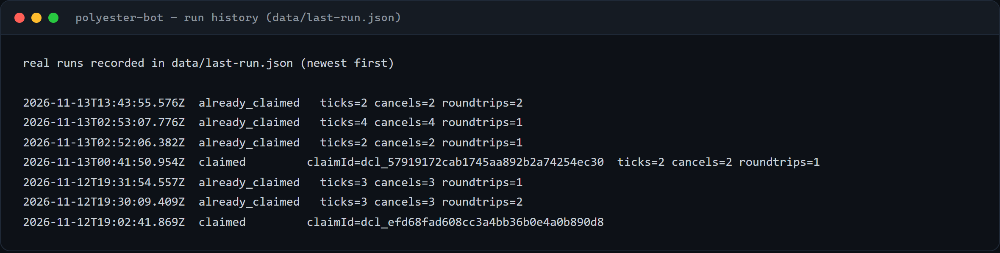

# polyester-bot

Daily automation for **Polyester Testnet DEX** (https://testnet.polyester.com).
Claims free **Paper Assets** for every account each day (00:00 UTC reset) and runs a
small randomized paper-trading activity engine so account history looks organic —
volume, trades, order counts and daily streaks are exactly what season checkpoints
and potential retro rewards measure.

Pure signed HTTP API (Ed25519) — **no browser needed for the daily routine**.

## Features

- Daily multi-account claim: `GET /v1/trading/daily-claim` → `POST .../claim`
- Paper activity engine (v1.1), built into `daily`:
  - Post-only limit ticks — resting buys below / sells above the book, cancelled a
    few seconds later. Never execute, zero risk, build order/cancel history.
  - Market IOC round trips — small BUY→SELL flips ($6–12) that produce real prints,
    fees and volume for checkpoint metrics. Balance floor guard included.
  - Auto-selects pairs the account can actually quote; sweeps leftover orders from
    crashed runs; never touches orders you placed manually.
- Humanization: shuffled account order, random 25–80s gaps, small daily skip chance
- Retry + backoff on transport/5xx; auth errors are never hammered
- Official Ed25519 signing spec (canonical string, RFC 3986 query normalization,
  SHA-256 body hash) — zero external dependencies
- Reports: `data/last-run.json` (machine) + `data/last-run.txt`
- Offline signer selftest: `node index.js selftest`

## Requirements

| Requirement          | Required | Notes                                                              |
| -------------------- | -------- | ------------------------------------------------------------------ |
| Node.js ≥ 22         | Yes      | no npm packages (0 dependencies)                                   |
| Polyester account    | Yes      | register in Chrome (Google/email or wallet, gasless)               |
| X **or** Discord     | Yes      | one must be linked in profile or claims fail                       |
| Main-account API key | Yes      | `ak_...` id + 64-hex Ed25519 secret, created once in browser       |
| Key policies         | Yes      | Daily Claims (read + claim) + Spot Trading                         |
| Capital              | No       | testnet, paper assets, no gas                                      |

## Setup (one-time per account, ~3 min in the browser)

1. Open https://testnet.polyester.com in a normal Chrome window (Cloudflare check — just click).
2. **Connect** → sign up with Google/email or a wallet → pick a username.
3. In your profile, link **X** or **Discord** (either is enough).
4. Go to https://testnet.polyester.com/account/api-keys → **New key** → *Generate in browser*.
   Copy the **Key ID** (`ak_...`) and the **64-hex private key** (shown only once!).
5. On the new key, attach policies: **Daily Claims (read + claim)** and **Spot Trading**.
6. Copy `config.json.example` → `config.json`, fill in per account:

```json
{
  "label": "w1",
  "keyId": "ak_XXXX",
  "apiPrivateKey": "64-hex-secret-no-0x",
  "subaccountId": ""
}
```

> Claims must go through a **Main Account key**. Subaccount-scoped keys are rejected.
> Leave `subaccountId` empty to credit the root account.

## Usage

```
node index.js status      today's claim state for every account
node index.js daily       daily claim + paper activity (humanized)
node index.js trade       paper activity only (no claims)
node index.js selftest    offline signer validation
DRY_RUN=1 node index.js daily   status only, never POSTs the claim
```

Schedule daily after 07:00 UTC+7 (reset is 00:00 UTC). Randomize the minute
(07:10–08:30 works well). To disable trading activity and keep claims only, set
`trade.enabled = false` in config.

## Screenshots

Real output from a live account (13 Nov 2026) — not mockups. The account label is
masked to `acc1` in this public repo; the unmasked copies live in the private repo.

Live claim state (HTTP 200, today's rewards already credited):


Daily run: claim state, balance guard, paper round trips:


Run history read straight from `data/last-run.json` (includes `claimId` of successful claims):



Ed25519 signer selftest (offline, no network):


## Security notes

- `config.json` (key id + secret) is gitignored — never share the private key.
- These keys cannot withdraw funds (no withdraw policy) — claim + paper trading only.
- Testnet risk profile: paper assets have no value; the only thing at stake is your
  competition positioning.

Built by LYID — https://github.com/layerairdrop
