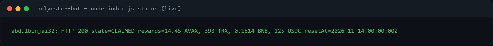
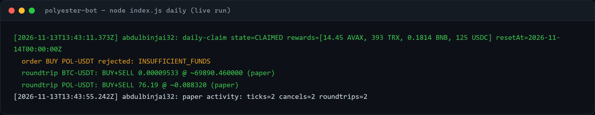
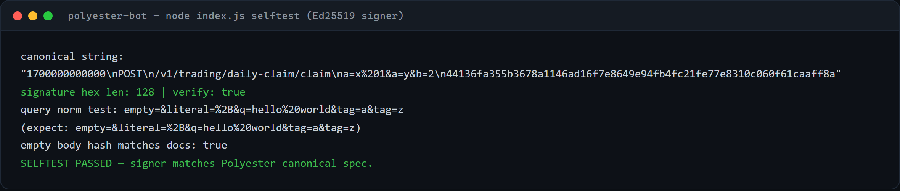

# Polyester Bot - Daily Paper Assets Claim

**Versi:** 1.1.1 · **Harga:** Rp 80.000 (~$5) · **Kontak pembelian:** [@rmndkyl](https://t.me/rmndkyl)

Bot automasi harian untuk **Polyester Testnet DEX** (https://testnet.polyester.com). Klaim **Paper Assets** tiap akun setiap hari (reset 00:00 UTC) + opsional aktivitas trading paper (pasang order lalu batalkan) supaya riwayat akun terlihat hidup untuk kepenting kompetisi & potensi airdrop retroaktif.

## Kebutuhan

| Item | Detail |
|---|---|
| Runtime | Node.js 18+ |
| Wallet | EVM / sesuai chain proyek (kamu sendiri) |
| Proxy | tidak perlu |
| Captcha | tidak perlu |
| Akses | akun proyek yang kamu kelola sendiri |

## Pembayaran

E-Wallet: DANA / GoPay / ShopeePay · Bank: BCA / Seabank · Crypto: contact for wallet address.
Pembeli menghubungi [@rmndkyl](https://t.me/rmndkyl), kirim bukti transfer, lalu terima license key.

---

Bot automasi harian untuk **Polyester Testnet DEX** (https://testnet.polyester.com).
Klaim **Paper Assets** tiap akun setiap hari (reset 00:00 UTC) + opsional aktivitas
trading paper (pasang order lalu batalkan) supaya riwayat akun terlihat hidup untuk
kepenting kompetisi & potensi airdrop retroaktif.

Murni HTTP API (Ed25519 signed request) — **tanpa browser untuk rutinitas harian**.

## Fitur

- Klaim harian multi-akun: `GET /v1/trading/daily-claim` → `POST .../claim` otomatis
- **Aktivitas trading paper (v1.1)** — built-in di `daily`, untuk metrik checkpoint musim
  (volume, trades, orders, streak) yang dipakai kompetisi & potensi retroaktif:
  - Post-only limit ticks: order BUY di bawah / SELL di atas buku order → resting →
    dibatalkan setelah beberapa detik (tidak pernah tereksekusi, jadi tidak ada risiko)
  - Market IOC round-trip: BUY → tahan sebentar → SELL → menghasilkan riwayat trade + fee
    nyata, ukuran kecil ($6-12 paper/acak), guard: saldo USDT di bawah floor = skip
  - Auto-pilih pair yang saldonya cukup (tidak spam INSUFFICIENT_FUNDS), sweep order
    sisa dari run yang crash (clientOrderId prefix `lyid-`), tidak pernah menyentuh
    order buatan manual kamu
- Humanisasi: urutan akun diacak, jeda acak 25–80 detik antar akun, peluang skip harian
- Retry + backoff untuk error transport/5xx; error auth (401/403) tidak di-hammer
- Tanda tangan request Ed25519 sesuai spesifikasi resmi (canonical string 5–6 baris,
  normalisasi query RFC 3986, hash body SHA-256) — tanpa dependency eksternal
- Laporan `data/last-run.json` (machine) + `data/last-run.txt` (kartu screenshot)
- Selftest signer offline: `node index.js selftest`

## Kebutuhan

| Kebutuhan            | Wajib? | Keterangan                                                        |
| -------------------- | ------ | ----------------------------------------------------------------- |
| Node.js ≥ 22         | Ya     | Tidak ada package npm (0 dependency)                              |
| Akun Polyester       | Ya     | Daftar via Chrome: Google/email atau wallet (gasless)             |
| X **atau** Discord   | Ya     | Salah satu harus ditautkan di profil, kalau tidak → `SOCIAL_VERIFICATION_REQUIRED` |
| API Key (Main Acct)  | Ya     | ID `ak_...` + private key 64 hex, dibuat sekali di browser        |
| Policy pada key      | Ya     | `READ_DAILY_CLAIMS` + `CLAIM_DAILY_REWARD` + `TRADE_SPOT` ( utk aktivitas trading) |
| Modal                | Tidak  | Testnet, paper assets, tanpa gas                                  |

## Setup (sekali per akun, ±3 menit via browser)

1. Buka https://testnet.polyester.com di Chrome biasa (ada Cloudflare check, klik saja).
2. **Connect** → daftar pakai Google/email atau wallet → pilih username.
3. Di profil, tautkan **X** atau **Discord** (salah satu cukup).
4. Buka https://testnet.polyester.com/account/api-keys → **New key** → *Generate in browser*.
   Salin **Key ID** (`ak_...`) dan **private key 64 hex** (muncul sekali!).
5. Pada key baru: attach policy yang mengizinkan **Daily Claims (read + claim)** dan,
   kalau mau pakai `--trade`, **Spot Trading** di pair `BTC-USDT`.
6. Salin `config.json.example` → `config.json`, isi per akun:

```json
{
  "label": "w1",
  "keyId": "ak_actualid",
  "apiPrivateKey": "64hex私钥tanpa0x",
  "subaccountId": ""
}
```

> Catatan: klaim hanya boleh lewat **Main Account key**. Key milik Subaccount ditolak.
> `subaccountId` (opsional) = tujuan reward; kosong = akun root.

## Cara pakai

```
node index.js status            cek state klaim hari ini semua akun
node index.js daily             klaim harian + aktivitas paper (humanized)
node index.js trade             hanya aktivitas trading paper (tanpa klaim)
node index.js selftest          validasi signer offline
DRY_RUN=1 node index.js daily   cek status saja, tidak POST claim
```

Untuk mematikan aktivitas trading (klaim saja): set `trade.enabled` = `false` di config.

Jadwalkan harian **setelah 07:00 WIB** (reset 00:00 UTC = 07:00 pagi WIB).
Disarankan acak menit, misalnya 07:10–08:30 WIB.

## Bukti jalan (screenshot)

Diambil dari run nyata akun utama (13 Nov 2026), bukan mockup. Label akun utuh
di repo private ini; versi publik di-mask jadi `acc1`.

Status live (HTTP 200, reward hari ini sudah masuk):



Run harian: state klaim + guard saldo + round-trip paper:



Riwayat run (dibaca dari `data/last-run.json`, termasuk `claimId` klaim sukses):


Selftest signer Ed25519 (offline, tanpa network):



## Struktur

```
index.js            CLI entry (status | daily | trade | selftest)
src/sign.js         canonical string + Ed25519 signing (sesuai docs resmi)
src/api.js          HTTP client bertanda tangan, retry/backoff
src/daily.js        loop harian multi-akun + humanisasi
src/trade.js        mesin aktivitas paper v1.1 (post-only ticks + IOC round trips)
src/config.js       loader config (fallback ke .example)
config.json         kredensial ANDA (tidak di-commit)
data/last-run.*     laporan run terakhir
tools/probe.js      uji konektivitas API (signed 401 = origin hidup)
```

## Troubleshooting

| Gejala                                   | Sebab & solusi                                                            |
| ---------------------------------------- | ------------------------------------------------------------------------- |
| `AUTH_SIGNATURE_INVALID` (401)           | Private key salah/sudah dirotasi. regenerate key & update config.         |
| `AUTH_API_KEY_ACCESS_DENIED`             | Key kurang policy daily-claim, atau key Subaccount → buat Main Acct key.  |
| `SOCIAL_VERIFICATION_REQUIRED`           | Akun belum menautkan X/Discord → tautkan di profil, sekali saja.          |
| `TIMESTAMP_SKEW`                         | Jam PC meleset >1 detik. sinkronkan waktu Windows (sync now).             |
| HTTP 403 tanpa JSON / "Just a moment"     | Terkena Cloudflare page (biasanya sementara). Bot retry; cek `tools/probe.js`. |
| state `UNAVAILABLE` terus                | Campaign reward hari itu belum aktif — normal, coba besok.                |
| state `PAYOUT_DELAYED`                   | Payout tertunda di sisi proyek; claim tercatat, dibayar otomatis.         |
| Banyak akun 1 IP                         | Rate login (AUTH_PUBLIC) dibagi per IP, tapi daily-claim harian ringan — aman. |

## Keamanan

- `config.json` (key ID + secret) di-gitignore; jangan pernah share private key.
- Key ini **tidak** bisa menarik dana (tidak ada withdraw policy) — khusus klaim/trade paper.
- Risk testnet: aset paper tidak bernilai; yang dipertaruhkan hanya posisi akun utk kompetisi.

Dibangun oleh LYID — https://github.com/layerairdrop